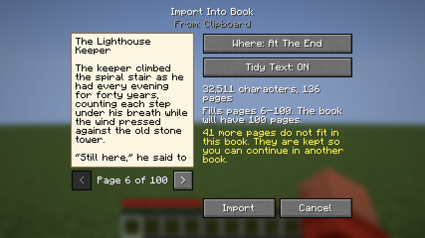
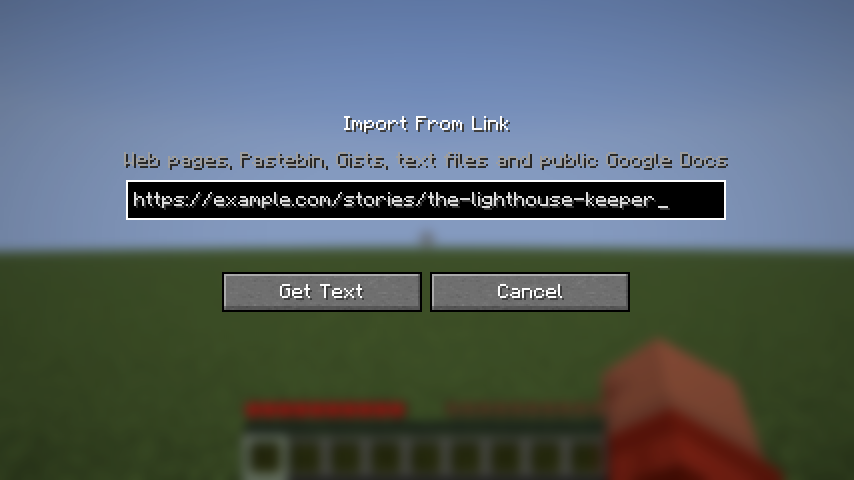

# Book Writer

Import long text into a Minecraft book and quill. Paste from your clipboard or straight from a
web link, check the result in a preview, and Book Writer spreads it over as many pages as it
needs.

A client-side [Fabric](https://fabricmc.net/) mod for Minecraft 1.21.7. Works in singleplayer
and on servers; the server does not need it.


## Features

- **Paste Text**: import the clipboard across as many pages as it takes.
- **Paste Link**: import the readable text of a web page, Pastebin, Gist or public Google Doc.
- **Preview first**: see the page count and flip through every page before anything changes.
- **Choose where it goes**: at the end, after the page you are on, or replacing the book.
- **Undo Import**: one click puts the book back the way it was.
- **Longer than one book?** The text that does not fit is kept, so you can continue in the next book.
- **Pages that match the game**: text is wrapped with Minecraft's own line wrapping, and no
  line breaks are forced into your paragraphs, so imported pages stay easy to edit.

## Installing

1. Install [Fabric Loader](https://fabricmc.net/use/) for Minecraft 1.21.7.
2. Put [Fabric API](https://modrinth.com/mod/fabric-api) in your `mods` folder.
3. Put the Book Writer jar in your `mods` folder. Get it from this repository's Releases
   page if a release is published there, or [build it yourself](#building).

## Using it

Open a book and quill. The Book Writer buttons sit beside the book, or in a row under
Sign / Done when the window is narrow.

| Button | What it does |
| --- | --- |
| **Paste Text** | Imports the clipboard. Shortcut: Ctrl+Shift+V (Cmd+Shift+V on macOS). Plain Ctrl+V still pastes into the current page as usual. |
| **Paste Link** | Asks for a link, downloads the page and imports its text. If the clipboard holds a link, it is filled in for you. |
| **Undo Import** | Puts the book back the way it was before the last import. |
| **Continue…** | Appears when the last import did not fit in one book. Open another book and press it to carry on where the text stopped. |

### The preview

Both paste buttons open a preview before the book is touched. It shows how many pages the
text needs and which pages it will fill, and lets you flip through them exactly as the book
will show them.


Two settings live here:

- **Where**: *At The End* adds pages after the last page with text. *After This Page* adds
  them after the page you were on (or onto it, if it is blank). *Replace Book* starts over
  from page 1, and warns you how many pages it will discard.
- **Tidy Text**: removes invisible characters, trailing spaces and runs of blank lines that
  tend to come along when copying from websites and documents.

Press **Import** (or Enter) and the pages are written. A message confirms how many, and
**Undo Import** is there if it is not what you wanted.


### Text that is too long for one book

A book holds 100 pages. When the text needs more, the preview tells you how many pages will
not fit. Import anyway, then open another book and quill and press **Continue…** to carry on
from exactly where the first book stopped.



### Importing from a link



Paste Link works with:

- **Web pages**: the article text is kept, and menus, sidebars, ads and footers are dropped.
- **Pastebin, GitHub Gists and GitHub files**: fetched as plain text.
- **Public Google Docs**: fetched as plain text. The document must be viewable by anyone
  with the link.
- **Direct links to text files**.

It cannot read pages that need a login, sit behind a paywall or build their text with
JavaScript, and it does not read PDFs. In those cases you get a message saying why.

**Privacy:** the page is downloaded by your own computer, directly from the site in the
link. Book Writer does not send your links or text anywhere else.

## Building

Requires Java 21.

```bash
./gradlew build
```

The mod jar is written to `build/libs/`.

## License

[MIT](LICENSE)
